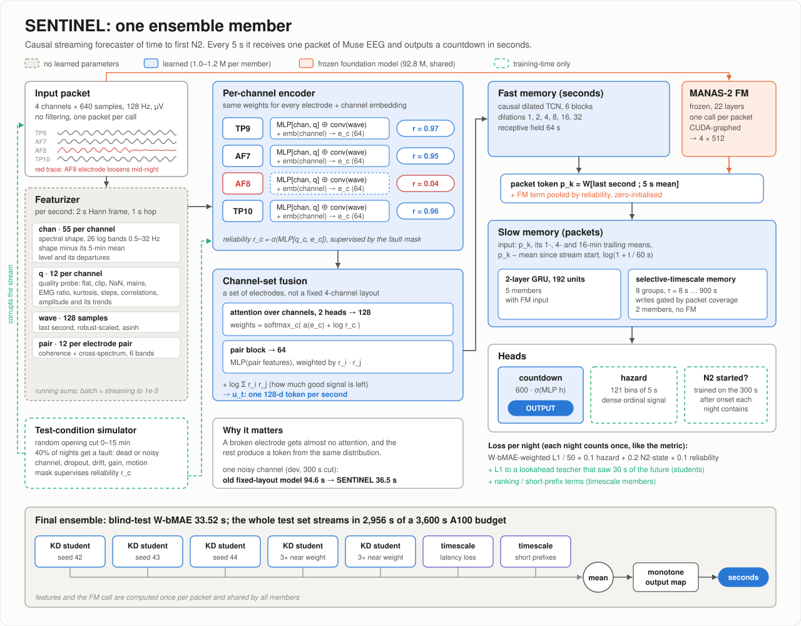
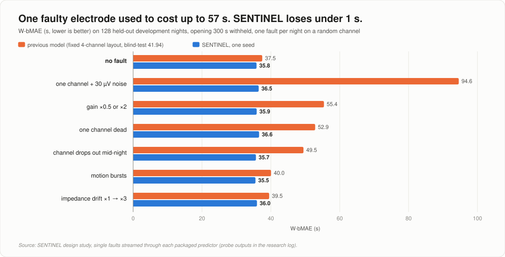
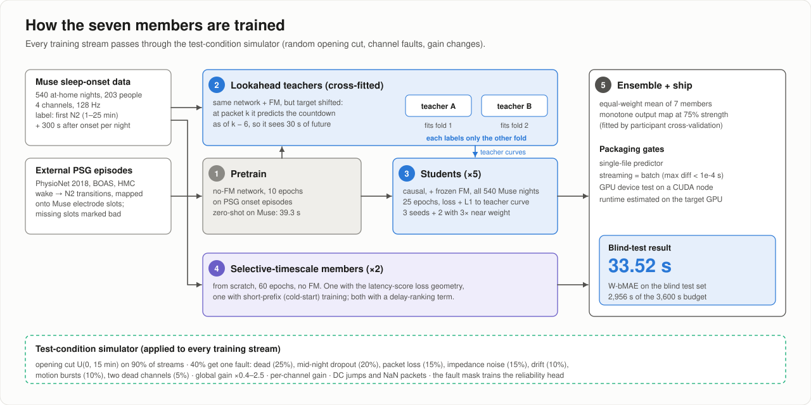

# SENTINEL: forecasting sleep onset from a 4-channel EEG headband

A causal, streaming model that watches a consumer EEG headband (Muse: TP9, AF7, AF8, TP10) and
predicts, every 5 seconds, **how many seconds remain until the sleeper reaches stage N2**. On an
independent blind test set it scores **33.52 s W-bMAE**, down from 50.24 s for my fine-tuned
foundation-model baseline and 50.98 s for a published sleep-staging CNN (Chambon et al., 2018)
evaluated on the same set.

The core idea is that the blind test set was not "more of the same data". It withheld the opening
minutes of each recording and contained electrode faults that the public data never shows. So the
model treats the four electrodes as a **set with learned per-channel reliability** rather than a fixed
layout, and it is trained under a **simulator of the test conditions**.



## Results

| Blind-test evaluation | W-bMAE (s) |
|---|---:|
| Published sleep-staging CNN (Chambon 2018) | 50.98 |
| My fine-tuned EEG foundation model (REVE) + GRU | 50.24 |
| My best clean-data model (fixed 4-channel layout) | 41.94 |
| SENTINEL, 6 seeds | 35.49 |
| + frozen MANAS-2 features, two selective-timescale members | 34.05 |
| + all 540 nights, output calibration | 33.89 |
| + lookahead-teacher distillation | 33.74 |
| **+ near-onset-weighted members (final, 7 members)** | **33.52** |

The blind test streams every recording packet by packet on one A100 with a 60-minute budget for the
whole set; the final 7-member ensemble needs 2,956 s.

**Fault robustness.** One noisy or dead electrode raised my previous model's error by up to 57 s.
SENTINEL loses under 1 s:



**What each part is worth** (development panel: 128 held-out nights from 40 seen + 88 unseen
people, macro over the two groups, final epoch, no checkpoint selection):

| Change | clean, 300 s cut | test-like mix | Notes |
|---|---:|---:|---|
| Full SENTINEL (one seed) | 35.84 | 35.73 | reference for the ablations below |
| without the quality probe and reliability gating | 36.69 | 37.30 | +1.6 s under faults |
| without the pairwise coherence block | 36.46 | 36.41 | |
| without the post-onset N2 head | 36.36 | 36.49 | |
| trained on clean data (no fault simulation) | 36.07 | **49.85** | fault training costs 0.2 s clean, saves 14 s |
| without opening-cut augmentation | 99.01 | 116.19 | the model must not assume it sees the start |
| Distillation from a 30 s lookahead teacher (3 seeds, paired) | −0.67 | −0.50 | every view improves |
| Frozen MANAS-2 packet features (3 seeds, paired) | −0.35 | −0.55 | zero-initialised residual |

More detail, including what did not work, is in [docs/RESULTS.md](docs/RESULTS.md).

## How it works

1. **Featurizer (no parameters).** For every second: 26-band log spectrum split into shape and level,
   their departures from 5-minute and since-start means, a 12-number signal-quality probe, the last
   second of waveform, and coherence for all six electrode pairs. Everything is computed with running
   sums, so the batch forward pass and the packet-by-packet stream agree to 1e-5.
2. **Per-channel encoder with reliability.** One shared encoder per electrode, plus a reliability head
   `r_c = σ(MLP[q_c, e_c])` supervised by the simulator's corruption mask.
3. **Channel-set fusion.** Attention over channels with `log r_c` added to the logits, and a pair block
   weighted by `r_i · r_j`. A dead electrode gets almost no weight, and the remaining ones produce a
   token from the same distribution.
4. **Two memories.** A causal dilated TCN over seconds (64 s receptive field), then a slow memory over
   packets fed with 1-, 4- and 16-minute trailing means, the departure from the stream mean, and the
   time since the *first received* packet. Five members use a GRU; two use a selective multi-timescale
   memory with learned time constants from 8 to 900 s.
5. **Heads.** The countdown `600 · σ(·)` is the output. Training adds a 121-bin hazard head and an
   "N2 has started" head trained on the 300 s after onset that every training night contains.
6. **Training.** PSG pretraining on public sleep-lab data mapped onto the Muse electrode slots, then
   cross-fitted *lookahead teachers* that see 30 s of the future, then causal students distilled from
   them. Every training stream goes through the test-condition simulator.



The metric matters as much as the model. W-bMAE weights errors by the true remaining time:
10× in the last 40 s, 5× at 40–90 s, 3× at 90–300 s, 1× beyond. On a typical night one window in the
last 40 s carries as much weight as about 120 far windows. The point loss uses these weights per recording, so the
training objective is the metric itself.

## Repository layout

```
src/sentinel/
  features.py    causal featurizer, standardizer
  model.py       Sentinel network, TCN, selective-timescale memory
  fm.py          frozen MANAS-2 encoder (re-implemented, no extra dependencies), CUDA-graph wrapper
  streaming.py   exact packet-by-packet ensemble inference, output calibration
  augment.py     test-condition simulator: opening cuts and channel faults
  losses.py      metric-weighted point loss, auxiliary heads, distillation, ranking, short-prefix
  metric.py      W-bMAE and the seen/unseen macro
  data.py        EEG-BIDS reader for the Muse dataset, PSG episode loader
scripts/
  train.py       one member from a recipe in configs/
  evaluate.py    streaming evaluation under test-like views
  export.py      self-contained single-file predictor for deployment
configs/         recipes for every member, the final ensemble, the development panel
tests/           streaming = batch, causality, metric identity, simulator, calibration
```

## Reproducing

```bash
pip install -r requirements.txt
# data: https://github.com/nemarDatasets/nm000287 (CC BY-NC-SA 4.0) -> data/nm000287
# MANAS-2 weights (Apache-2.0) -> weights/manas2/{model.safetensors,positions.json}

python scripts/train.py --config configs/pretrain_psg.yaml --out runs/pretrain
for f in 0 1; do
  python scripts/train.py --config configs/teacher.yaml --fold $f --out runs/teacher-f$f
  python scripts/train.py --config configs/teacher.yaml --fold $f --init runs/teacher-f$f/final_ema.pt \
      --dump-teacher cache/kd/teacher-f$f.npz
done
for s in 42 43 44; do python scripts/train.py --config configs/student_kd.yaml --seed $s --out runs/student-s$s; done
for s in 42 43; do python scripts/train.py --config configs/student_kd_near3.yaml --seed $s --out runs/student-near3-s$s; done
python scripts/train.py --config configs/timescale_latency.yaml --out runs/timescale-latency
python scripts/train.py --config configs/timescale_prefix.yaml --out runs/timescale-prefix

python scripts/evaluate.py --ensemble configs/ensemble_final.yaml --conditions clean300 mix short
python scripts/export.py   --ensemble configs/ensemble_final.yaml --out dist/sentinel
```

A student with FM inputs takes roughly an hour on one consumer GPU. The PSG episode cache is built from PhysioNet
2018, BOAS and HMC; see `sentinel/data.py` for the montage mapping.

**Verification.** This code is a clean rewrite of the research code. Loaded with the deployed weights,
it reproduces the deployed package packet by packet: the largest difference was 9e-5 s over five full
nights. `python -m pytest tests` checks streaming against batch, strict causality, and that the
metric-weighted loss equals the evaluation metric.

## Development protocol

- Participants, not nights, are the unit of every split: 372 training nights, 128 development nights
  (40 from people seen in training, 88 from unseen people), as in the blind test set's seen/unseen macro.
- Final epoch with EMA weights; no checkpoint selection on the development panel.
- Claims of improvement need three seeds and a paired participant bootstrap. Single-seed gains under
  about 1 s were treated as noise. The seed-to-seed standard deviation was about 0.7 s.

## Licenses

Code: MIT. The Muse dataset (CC BY-NC-SA 4.0) and the MANAS-2 weights (Apache-2.0) are not included;
download them from their sources. External PSG corpora: PhysioNet 2018, BOAS (OpenNeuro ds005555), HMC
(PhysioNet, CC BY 4.0).
